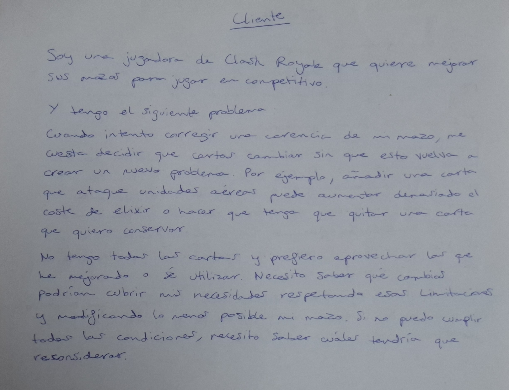

# Ficha del cliente

Esta es la fotografía heredada del objetivo 0. Antes de entregar, la autora debe comprobar que recoge el problema actual de preparar mazos de guerra sin repetir cartas. Si corresponde a una propuesta anterior, debe actualizarla mediante el ejercicio de rol; la planificación no acredita por sí sola que esa actualización se haya realizado.
